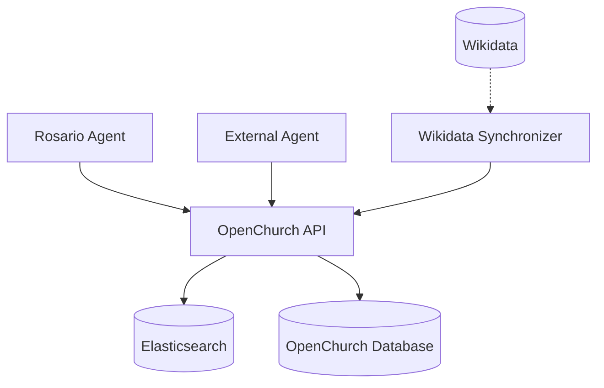

<h1 align="center">💒<br>OpenChurch</h1>

<p align="center">
  <strong>A collaborative API for Catholic Church data.</strong><br>
  Dioceses, parishes, and churches · Multiple data sources · Wikidata synchronization
</p>

<p align="center">
  <a href="https://app.codacy.com/gh/hozana/openchurch/dashboard?utm_source=gh&amp;utm_medium=referral&amp;utm_campaign=Badge_grade"></a>
  <a href="https://app.codacy.com/gh/hozana/openchurch/dashboard?utm_source=gh&amp;utm_medium=referral&amp;utm_campaign=Badge_coverage"></a>
</p>

<p align="center">
  <a href="https://open-church.io/">Website</a> ·
  <a href="https://api.openchurch.local/api/docs">Local API documentation</a> ·
  <a href="#development">Development</a> ·
  <a href="#api-examples">API examples</a>
</p>

---

OpenChurch provides an API for finding and contributing data about dioceses, parishes,
and churches. It powers the [Rosario app](https://rosario.app/), helping people join
a parish to pray the rosary.

Church structures and information can be complex. Rather than treating every value
as definitive, OpenChurch records data from multiple agents, with a source and
reliability level for each field.

## Architecture

The `backend` service exposes the API using Symfony and API Platform. The `python`
service retrieves data from Wikidata and imports it through the API. Elasticsearch
indexes communities (dioceses and parishes) for search, while the database stores
the underlying records.



## Development

### Project setup

Install Docker with Docker Compose before starting.

1. Clone the repository and enter the project directory:

   ```sh
   git clone git@github.com:hozana/openchurch.git
   cd openchurch
   ```

2. Add the following entry to `/etc/hosts`:

   ```text
   127.0.0.1 api.openchurch.local
   ```

3. Build and start the containers:

   ```sh
   docker compose build
   docker compose up
   ```

4. Open the [local API documentation](https://api.openchurch.local/api/docs) to
   explore the API, or the [synchronization dashboard](https://api.openchurch.local/dashboard)
   to monitor data imports.
5. Once data has been imported, [index the communities](#search-indexing) to make
   dioceses and parishes searchable. You can then query the API.

### Container access

To open a shell in a running container, use a service name from [compose.yaml](compose.yaml):

```sh
docker compose exec <service> bash
```

For example, `docker compose exec backend bash` opens a shell in the API container.

### Search indexing

To index or reindex communities stored in the database, run:

```sh
docker compose exec backend bin/console app:index:communities
```

## Data model

A **Place** (such as a church) or **Community** (such as a diocese or parish) holds
named fields. The available field names are defined in
[`FieldPlace`](src/Field/Domain/Enum/FieldPlace.php) and
[`FieldCommunity`](src/Field/Domain/Enum/FieldCommunity.php).

Each field records a value, the agent that supplied it, and a reliability level.
Values can have different types, including strings, numbers, dates, and references
to another Place or Community. For example, a parish's `parentCommunityId` field
links it to its diocese.

## Wikidata synchronization

### Import data

Run the synchronizer from the `python` service, choosing `diocese`, `parish`, or
`church` for `--entity-only`:

```sh
docker compose exec python /opt/venv/bin/python /app/synchro.py --entity-only diocese
```

Monitor progress in the [synchronization dashboard](https://api.openchurch.local/dashboard).
Import times vary: dioceses typically take several minutes, parishes around
15–30 minutes, and churches around two hours.

### How it works

The synchronizer in [`scripts/synchro.py`](scripts/synchro.py) retrieves Wikidata
records in batches using SPARQL queries. Redis tracks batch progress so interrupted
imports can resume and concurrent processes can work on different batches.

For each batch, the script sends `PUT` requests to `/api/places/upsert` for churches
or `/api/communities/upsert` for dioceses and parishes. The stored `wikidataId`
allows existing records to be updated and new records to be inserted.

## API examples

These examples use the local development API. See the
[API documentation](https://api.openchurch.local/api/docs) for available endpoints
and filters.

### Find dioceses by name

```text
https://api.openchurch.local/api/communities?type=diocese&itemsPerPage=10&page=1&name=aix%20en%20provence
```

### Find parishes by postal code

```text
https://api.openchurch.local/api/communities?type=parish&contactZipcodes[]=40270&contactZipcodes[]=30000
```

### Example response

The collection includes each community's fields, contributing agent, and source metadata.

<details>
<summary>View the full JSON response</summary>

```json
{
	"@context": "/api/contexts/Community",
	"@id": "/api/communities",
	"@type": "Collection",
	"totalItems": 2,
	"member": [
		{
			"@id": "/api/communities/0194cc58-9ae2-754e-aaa4-0f98ab46bb18",
			"@type": "Community",
			"id": "0194cc58-9ae2-754e-aaa4-0f98ab46bb18",
			"fields": [
				{
					"@type": "Field",
					"@id": "/api/.well-known/genid/636173db41ef2a4797d1",
					"name": "contactCountryCode",
					"value": "fr",
					"agent": {
						"@type": "Agent",
						"@id": "/api/.well-known/genid/00694474629cbf0d779a",
						"id": "0193e4d8-4f7a-7ae1-aaa2-8145d3caee4a",
						"name": "CLI_PYTHON"
					},
					"reliability": "high",
					"engine": "scraper",
					"source": "Wikidata",
					"explanation": "https://www.wikidata.org/wiki/Q1363973"
				},
				{
					"@type": "Field",
					"@id": "/api/.well-known/genid/1005b8c821e43a34a907",
					"name": "name",
					"value": "Archidiocèse d'Aix-en-Provence et Arles",
					"agent": {
						"@type": "Agent",
						"@id": "/api/.well-known/genid/00694474629cbf0d779a",
						"id": "0193e4d8-4f7a-7ae1-aaa2-8145d3caee4a",
						"name": "CLI_PYTHON"
					},
					"reliability": "high",
					"engine": "scraper",
					"source": "Wikidata",
					"explanation": "https://www.wikidata.org/wiki/Q1363973"
				},
				{
					"@type": "Field",
					"@id": "/api/.well-known/genid/0fb42f164359d0774415",
					"name": "type",
					"value": "diocese",
					"agent": {
						"@type": "Agent",
						"@id": "/api/.well-known/genid/00694474629cbf0d779a",
						"id": "0193e4d8-4f7a-7ae1-aaa2-8145d3caee4a",
						"name": "CLI_PYTHON"
					},
					"reliability": "high",
					"engine": "scraper",
					"source": "Wikidata",
					"explanation": "https://www.wikidata.org/wiki/Q1363973"
				},
				{
					"@type": "Field",
					"@id": "/api/.well-known/genid/6c8ccedbe6861c1935d4",
					"name": "wikidataId",
					"value": 1363973,
					"agent": {
						"@type": "Agent",
						"@id": "/api/.well-known/genid/00694474629cbf0d779a",
						"id": "0193e4d8-4f7a-7ae1-aaa2-8145d3caee4a",
						"name": "CLI_PYTHON"
					},
					"reliability": "high",
					"engine": "scraper",
					"source": "Wikidata",
					"explanation": "https://www.wikidata.org/wiki/Q1363973"
				},
				{
					"@type": "Field",
					"@id": "/api/.well-known/genid/4ca791f1e444898a57ee",
					"name": "wikidataUpdatedAt",
					"value": "2025-03-26T14:01:10+00:00",
					"agent": {
						"@type": "Agent",
						"@id": "/api/.well-known/genid/00694474629cbf0d779a",
						"id": "0193e4d8-4f7a-7ae1-aaa2-8145d3caee4a",
						"name": "CLI_PYTHON"
					},
					"reliability": "high",
					"engine": "scraper",
					"source": "Wikidata",
					"explanation": "https://www.wikidata.org/wiki/Q1363973"
				}
			]
		},
		{
			"@id": "/api/communities/0194cc58-8931-753b-b77c-f3a75fe04ba8",
			"@type": "Community",
			"id": "0194cc58-8931-753b-b77c-f3a75fe04ba8",
			"fields": [
				{
					"@type": "Field",
					"@id": "/api/.well-known/genid/d9415c4d44f906ff3a69",
					"name": "contactCountryCode",
					"value": "fr",
					"agent": {
						"@type": "Agent",
						"@id": "/api/.well-known/genid/00694474629cbf0d779a",
						"id": "0193e4d8-4f7a-7ae1-aaa2-8145d3caee4a",
						"name": "CLI_PYTHON"
					},
					"reliability": "high",
					"engine": "scraper",
					"source": "Wikidata",
					"explanation": "https://www.wikidata.org/wiki/Q866776"
				},
				{
					"@type": "Field",
					"@id": "/api/.well-known/genid/abb294b073a833cdd952",
					"name": "name",
					"value": "Diocèse d'Aire et Dax",
					"agent": {
						"@type": "Agent",
						"@id": "/api/.well-known/genid/00694474629cbf0d779a",
						"id": "0193e4d8-4f7a-7ae1-aaa2-8145d3caee4a",
						"name": "CLI_PYTHON"
					},
					"reliability": "high",
					"engine": "scraper",
					"source": "Wikidata",
					"explanation": "https://www.wikidata.org/wiki/Q866776"
				},
				{
					"@type": "Field",
					"@id": "/api/.well-known/genid/ea3c0c5515f041c6a3d0",
					"name": "type",
					"value": "diocese",
					"agent": {
						"@type": "Agent",
						"@id": "/api/.well-known/genid/00694474629cbf0d779a",
						"id": "0193e4d8-4f7a-7ae1-aaa2-8145d3caee4a",
						"name": "CLI_PYTHON"
					},
					"reliability": "high",
					"engine": "scraper",
					"source": "Wikidata",
					"explanation": "https://www.wikidata.org/wiki/Q866776"
				},
				{
					"@type": "Field",
					"@id": "/api/.well-known/genid/607b601ece57c173c729",
					"name": "wikidataId",
					"value": 866776,
					"agent": {
						"@type": "Agent",
						"@id": "/api/.well-known/genid/00694474629cbf0d779a",
						"id": "0193e4d8-4f7a-7ae1-aaa2-8145d3caee4a",
						"name": "CLI_PYTHON"
					},
					"reliability": "high",
					"engine": "scraper",
					"source": "Wikidata",
					"explanation": "https://www.wikidata.org/wiki/Q866776"
				},
				{
					"@type": "Field",
					"@id": "/api/.well-known/genid/516c82999a0bbc3e23d0",
					"name": "wikidataUpdatedAt",
					"value": "2025-05-10T08:18:06+00:00",
					"agent": {
						"@type": "Agent",
						"@id": "/api/.well-known/genid/00694474629cbf0d779a",
						"id": "0193e4d8-4f7a-7ae1-aaa2-8145d3caee4a",
						"name": "CLI_PYTHON"
					},
					"reliability": "high",
					"engine": "scraper",
					"source": "Wikidata",
					"explanation": "https://www.wikidata.org/wiki/Q866776"
				}
			]
		}
	],
	"view": {
		"@id": "/api/communities?itemsPerPage=10&name=aix%20en%20provence&type=diocese",
		"@type": "PartialCollectionView"
	},
	"search": {
		"@type": "IriTemplate",
		"template": "/api/communities{?type,messeInfoId,parentWikidataId,name}",
		"variableRepresentation": "BasicRepresentation",
		"mapping": [
			{
				"@type": "IriTemplateMapping",
				"variable": "type",
				"property": "type",
				"required": false
			},
			{
				"@type": "IriTemplateMapping",
				"variable": "messeInfoId",
				"property": "wikidataId",
				"required": false
			},
			{
				"@type": "IriTemplateMapping",
				"variable": "parentWikidataId",
				"property": "parentWikidataId",
				"required": false
			},
			{
				"@type": "IriTemplateMapping",
				"variable": "name",
				"property": "name",
				"required": false
			}
		]
	}
}
```

</details>
